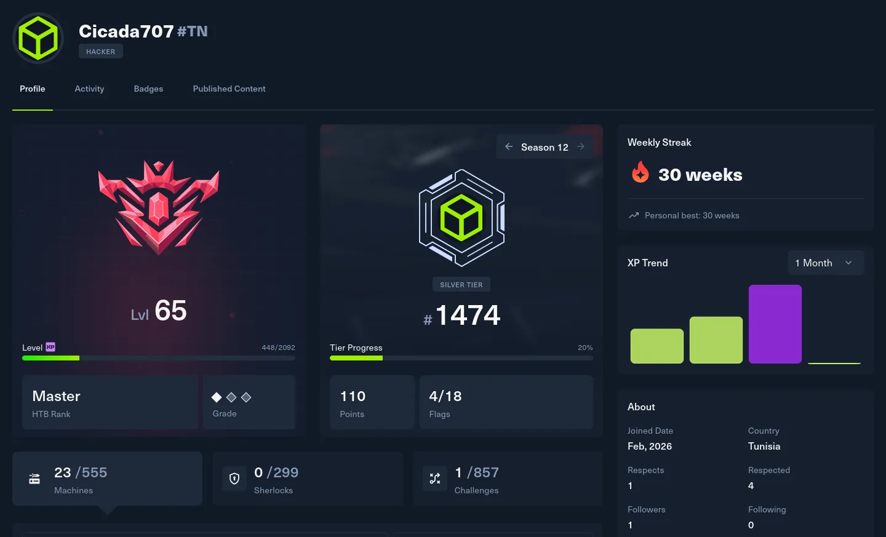
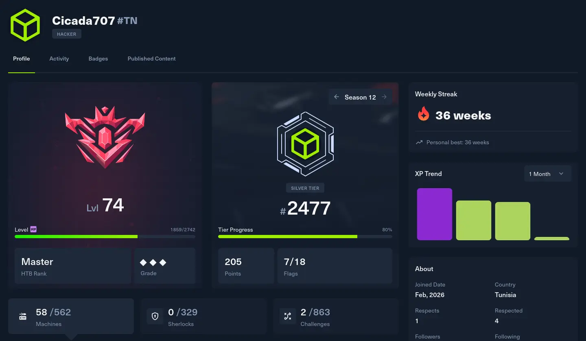
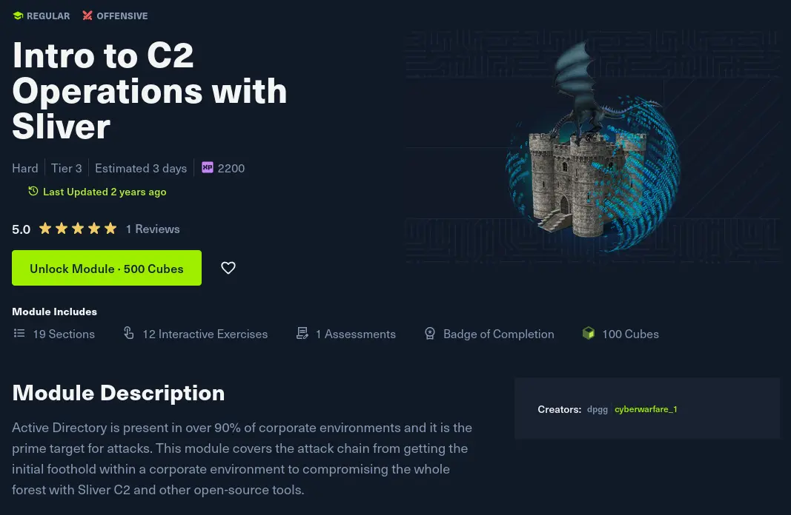

I'm a person that dislikes sudden changes in routine , that's why i felt lost after the challenge ended and I had to make changes to my routine . That doesn't mean I didn't decide what's next !

# Looking back 

here is my profile before and after :

## what did I learn 

damn what did I not learn ? there's still more shit out there than I came across during this month ? damn 
Seriously though It was a humbling experience to say the least , which makes me all the more excited to keep moving forward and maybe oneday even surpass ippsec and 0xdf (let me dream )

# What's next 

Now now , most people would recommend unlocking the using crackmapexec module ( tier 3 ) , which i could see the argument for . BUT i managed to gather 1000 cubes xD . So, I can open 2 tier 3 modules . You'd think I'd open 'Using Crackmapexec' BUT NOPE I ain't a responsible man 

Next target 

Intro to C2 Operations with sliver module:

Why ? because it sound f**king cool , and after it I'll try to solve puppet (the mini pro lab)100% without reading the writeups . What comes after that ? IDK 
