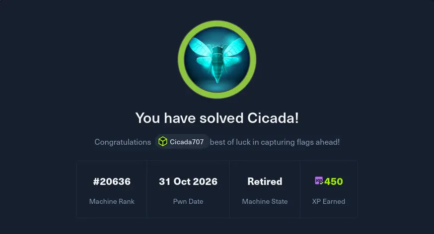
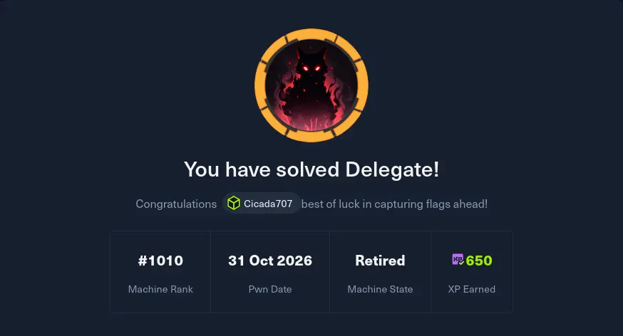

--- 
title: 30-Days-Challenge Day 19
date: 2026-10-31
categories: [30 day challenge]
tags: [HackTheBox,brainf*ck]
--- 

Our IEE Student Branch hosted an event for IEEXTREME challenge that lasted from 12pm to 8 am , i went to help out my colleagues so i didn't get much sleep but since the mood felt like a CTF i opened my laptop and chose 2 machines to treat as a CTF . I have to admit that for the delegate machine following Instructions on exploiting unconstrained delegation failed and I had to open 0xdf's writeup on the machine and followed from there (it still failed with weird errors that had me practice network troubleshooting (thanks to ippsec's sidequests in his videos I remembered ))

Anyways,Day 19 wrapped up ! 
