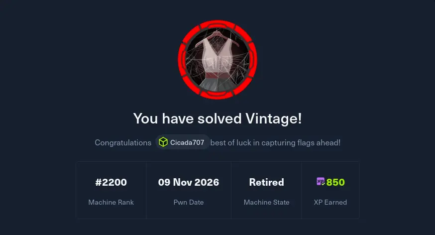

--- 
title: 30-Days-Challenge Day 28
date: 2026-11-09
categories: [30 day challenge]
tags: [HackTheBox,brainf*ck]
--- 

It's coming to an end soon ...:( 
And of course as is the usual with HackTheBox , you never leave a challenge feeling confident 

# Part 1 : Pwning Vintage ( hard windows)

MADNESS . Ain't no way I could've solved it on my own is just a day . It would've taken me at least a week (considering minimal rabbit holes) . So of course I had to rely on the good old writeup . But hey ! at least I understood all of the concepts mentioned so that should count as something right ?

# Tomorrow's machine : Sekhmet (Insane windows )

HAHAHHAHAHAHHAHAHAHAHHAHAHHAHAHAHHAHAHAAAAAAAAAAAAAAAAAAAAHHAHAHAH . LOL insane windows , LOL . Yeah I won't even bother with trying to solve it on my own .
Tomorrow's challenge : UNDERSTANDING WHAT THE MACHINE IS EVEN ABOUT !!!

Anyways Day 28 wrapped up ! 
